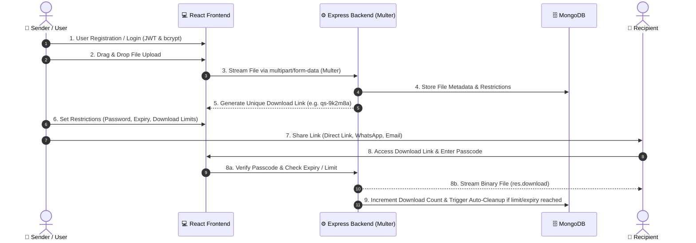

# QuickShare - Secure File Sharing and Simplified Digital Transfer

> **Academic Project: BE_A**  
> **Project Guide:** Prof. Sachin Kasare  
> **Group Members:** Anushka Kangane, Jui Katkade, Radhika Kulkarni, Shravani Khanvilkar  

---

## 🌟 Project Overview

**QuickShare** is an open-source, full-stack file-sharing platform designed to provide a fast, secure, and user-friendly alternative to traditional file-transfer platforms like WeTransfer, email attachments, and messaging apps.

It empowers users to upload files of any standard type (up to 500 MB), generate collision-free unique short download links, set access controls (passcode protection, custom expiration time, maximum download limits), and track transfer analytics via an interactive user dashboard.

---

## 🛠️ Complete Technology Stack

| Layer | Technology | Purpose / Responsibilities |
|---|---|---|
| **Frontend UI** | **React.js (Vite)** | Responsive single-page application, drag-and-drop file uploader, real-time upload progress bar, glassmorphic styling, recipient download page, user dashboard. |
| **Icons & Design** | **Lucide Icons & CSS3** | Modern aesthetic with glassmorphism, gradient accents, and micro-animations. |
| **Backend Framework** | **Node.js & Express.js** | Modular REST API, route handlers, error middleware, and static streaming. |
| **File Processing** | **Multer** | Multi-part form data handler, disk storage engine, unique collision-free filename hashing. |
| **Database** | **MongoDB (Mongoose ODM)** | Metadata storage (file name, byte size, short codes, expiration dates, download counters, user accounts). |
| **Authentication** | **JWT (JSON Web Tokens)** | Stateless authentication sessions via `Authorization: Bearer <token>`. |
| **Security & Cryptography** | **bcryptjs** | One-way password hashing (salt rounds: 10) for both user accounts and file-level passcodes. |
| **Background Cleanup** | **Node.js Interval Janitor** | Automated cron/interval worker that purges expired physical files from disk storage. |

---

## 🔄 9-Step Workflow Implementation (As Per Poster)



---

## 🚀 How to Run the Project Locally

### Prerequisites:
- [Node.js](https://nodejs.org/) (v18 or higher recommended)
- [MongoDB](https://www.mongodb.com/) (Running locally on port 27017 or a MongoDB Atlas URI)

### 1. Start the Backend API Server:
```bash
cd backend
npm install
npm run dev
```
*The backend starts at `http://localhost:5000` with health check available at `http://localhost:5000/api/health`.*

### 2. Start the Frontend React UI:
```bash
cd frontend
npm install
npm run dev
```
*The frontend starts at `http://localhost:5173` with automatic API proxy forwarding to `:5000`.*

---

## 📂 Project Architecture Directory Tree

```
quickshare/
├── backend/
│   ├── src/
│   │   ├── config/
│   │   │   └── db.js                 # MongoDB connection & logging
│   │   ├── controllers/
│   │   │   ├── authController.js     # User registration, login, and JWT verification
│   │   │   └── fileController.js     # Upload, download stream, metadata, and deletion
│   │   ├── middleware/
│   │   │   ├── authMiddleware.js     # Protect & optionalAuth JWT validators
│   │   │   └── uploadMiddleware.js   # Multer disk storage and file naming
│   │   ├── models/
│   │   │   ├── User.js               # User account schema (name, email, passwordHash)
│   │   │   └── File.js               # File metadata schema (name, size, uniqueCode, expiresAt)
│   │   ├── routes/
│   │   │   ├── authRoutes.js         # /api/auth routes
│   │   │   └── fileRoutes.js         # /api/files routes
│   │   ├── services/
│   │   │   └── cleanupService.js     # Periodic janitor worker for expired files
│   │   └── server.js                 # Main Express server bootstrapper
│   ├── uploads/                      # Local physical storage directory
│   ├── .env                          # Environment secrets and configuration
│   └── package.json
│
├── frontend/
│   ├── src/
│   │   ├── components/
│   │   │   ├── AuthModal.jsx         # Sign in & sign up popup
│   │   │   └── Dropzone.jsx          # Drag-and-drop file upload with progress bar
│   │   ├── context/
│   │   │   └── AuthContext.jsx       # Global JWT session management
│   │   ├── pages/
│   │   │   ├── Dashboard.jsx         # User transfers list, analytics, and delete buttons
│   │   │   └── DownloadPage.jsx      # Recipient download and passcode unlock portal
│   │   ├── App.jsx                   # Main routing container and navigation header
│   │   ├── index.css                 # Glassmorphic dark design system
│   │   └── main.jsx                  # React DOM mount point
│   ├── index.html
│   ├── vite.config.js                # Vite build and proxy settings
│   └── package.json
└── README.md
```

---

## 🎓 Academic Viva & Presentation Q&A (For BE Defense)

### Q1: Why do we use Multer diskStorage instead of saving files directly in MongoDB?
> **Answer:** Databases like MongoDB are optimized for structured, indexed documents. Storing large binary files (BLOBs) directly inside MongoDB causes heavy database bloat, degrades RAM caching, and slows down index lookups. Using Multer's `diskStorage` allows us to store the heavy binary bytes on disk/cloud storage while keeping lightweight metadata (file name, byte size, hash, expiration) in MongoDB.

### Q2: How does bcrypt password hashing work for both user accounts and file passcodes?
> **Answer:** `bcrypt` uses a one-way mathematical hashing algorithm combined with a random 10-round salt (`bcrypt.genSalt(10)`). This ensures the original password cannot be reversed or decrypted. When a user or recipient enters a password, we run `bcrypt.compare(enteredPassword, storedHash)` to verify legitimacy without exposing the plain-text password.

### Q3: How are expired files cleaned up?
> **Answer:** QuickShare implements an automated background cleanup worker in `cleanupService.js` that periodically queries MongoDB for files where `expiresAt <= now` or `downloadCount >= maxDownloads`. It removes the physical file from disk using `fs.unlinkSync()` to reclaim hard drive storage and marks the database record as `EXPIRED`.

### Q4: Why are download links generated with random codes (`qs-xxxxxx`) instead of incremental IDs (`1, 2, 3`)?
> **Answer:** Incremental IDs make platforms vulnerable to Insecure Direct Object References (IDOR), allowing anyone to guess links and download strangers' files. QuickShare generates cryptographic random hexadecimal strings (`crypto.randomBytes(4)`), ensuring collision-free, unguessable URLs.
